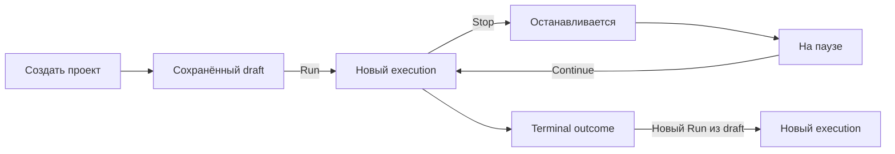
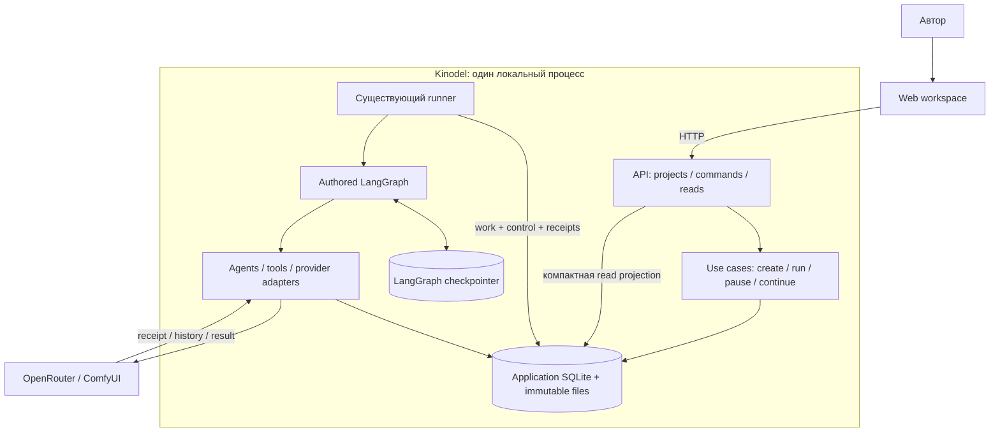
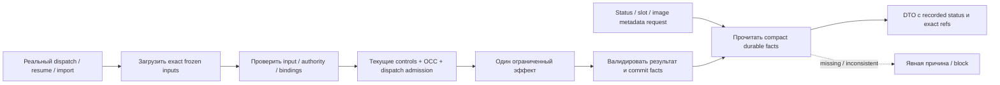

# Runtime fix: отзывчивость и Run / Stop / Continue

## 1. Цель и статус документа

**Сначала устранить измеренные блокировки управляющего контура, затем отделить проект от запуска и реализовать настоящую паузу execution.** Пользователь должен создавать и редактировать проект без генерации, запускать его через Run, приостанавливать через Stop и продолжать тот же запуск через Continue.

Главный принцип упрощения: **показать состояние выполнения — не значит повторно доказать корректность всех его входов**. Полная валидация остаётся на границах подготовки, загрузки исполняемых входов, импорта и применения результата; статус и занятость читают компактные сохранённые факты.

Документ объединяет необходимые представления канона [design-feature](../../skills/design-feature/SKILL.md): исследование, архитектуру, поведение, решения, хранение, предлагаемые API-контракты и проверку. По запросу всё собрано в одном файле. Раздел 9 задаёт порядок архитектурных этапов и их результаты, **не утверждённый пофайловый code plan**.

- **Gate 1:** согласовать архитектуру и критерии этого документа.
- После согласования семантики выполнить изолированный proof graph-step pause (§7.2): он обязателен **до подробного code plan управления и фиксации его storage/delivery схемы**.
- **Gate 2:** согласовать ограниченный code plan соответствующего среза до его реализации. Proof — отдельный согласуемый технический эксперимент, не интеграция паузы в приложение.
- Оптимизация измеренных горячих путей проходит собственный ограниченный code plan/review; её не задерживает проектирование Project/Stop/Continue API или proof паузы. Изменяемый read DTO согласуется в своём срезе.

**Gate 1 пройден:** после уточнения трёх замечаний пользователь запросил code plan. [Изолированный proof 0a](../../test-results/README.md#runtime-graph-step-pause-proof--16-october-2026) выполнен; выбранный механизм описан в §7.2. [Code plan](runtime-fix/plan/README.md) подготовлен отдельно и ожидает Gate 2. Приёмка интегрированного управления этим не заявляется.

Общий first-build статус остаётся в [Local MVP](../roadmap-mvp.md), генерация — в [ComfyUI roadmap](../roadmap-comfyui.md). Этот документ описывает изменение; результаты проверок и измерения хранятся только в [test-results/README.md](../../test-results/README.md).

## 2. Основания: что подтверждено и что ещё не доказано

### 2.1. Исходный аудит

Источник измерений и воспроизводимых скриптов: [Read-only responsiveness audit — 16 October 2026](../../test-results/README.md#read-only-responsiveness-audit--16-october-2026).

На исследованных данных image list занимал около 5,26 с, `_native_slot` — до 5,36 с; 50-мс asyncio heartbeat просыпался лишь после завершения синхронной проверки слота. Профиль относит основную стоимость к повторному разбору Wardrobe config/repair request с inline base64, а не к SQL или исключительно PNG.

Это доказательство блокировки event loop в указанных read/worker-путях. Оно **не** доказывает историческое замедление ровно в 100 раз, точную длительность каждого `/process` или минутного startup. Новые показатели должны измеряться на сопоставимых fixtures; старые цифры не являются целевым SLA.

### 2.2. Сверка с текущим рабочим деревом

Ссылки ниже относятся к исходникам на дату документа; дерево содержит незавершённые изменения.

| Факт | Источник | Следствие для рефакторинга |
|---|---|---|
| Slot lookup вызывает полные `_facts` до использования terminal observation | `backend/image_group_worker.py:188–209` | Упростить чтение occupancy, сохранив terminal evidence |
| Submission preview восстанавливает job, batch, references и native wire | `backend/portrait_submission_store.py:199–259` | Не использовать preview как обязательную операцию для статуса |
| Reference read заново разрешает родителей и строит final graph | `backend/anchor_reference_store.py:304–385` | Разделить сохранённые transfer facts и подготовку/проверку эффекта |
| Wardrobe read разбирает config и заново строит repair request | `backend/wardrobe_store.py:209–261`; `backend/openrouter_wardrobe.py:246`; `backend/domain.py:31` | Разделить чтение committed result и восстановление вызова модели |
| Список изображений читает originals и запускает полный manifest reader | `backend/image_reads.py:120–131,162–227` | Новый metadata read не должен наследовать стоимость и смысл проверки bytes |
| Async HTTP handlers напрямую вызывают синхронные image readers | `backend/api.py:680–707` | Удалить тяжёлую работу из цикла событий; при необходимости вынести ограниченную byte-проверку с собственным read connection |
| До readiness выполняется `runtime.run()`, между sweep — 200 мс | `backend/api.py:426–459` | Разделить открытие API и производственную работу |
| Close дожидается работы через shield; native cancellation повторно выбрасывается | `backend/story_control.py:218–232`; `backend/story_runner.py:603–623` | Отдельно обработать ожидаемую отмену и ограничить сетевое ожидание |
| Создание нового UI-запуска сразу генерирует project ID и отправляет start | `web/src/pages/workspace/Workspace.tsx:228–230,272–276` | Проекты сейчас представлены через executions |
| Start атомарно создаёт execution и pending start work | `backend/story_start.py:245–283` | Это база Run, но не Create project |
| Текущие controls — cancel/retry; самостоятельной pause-записи нет | `backend/database.py:119`; `backend/story_control.py:24–61,126–139`; `web/src/features/commands/RunControls.tsx:6–19` | Stop нельзя получить переименованием Cancel или `_stopping` |
| Continue смешивает reconcile, image handoff и receipt-only dispositions | `backend/continue_command.py:388–441` | Новая Continue должна только снимать pause |
| UI уже ограничил Continue POST действиями resume/start_images | `web/src/features/commands/ContinueControls.tsx:73–89` | Часть no-op уже убрана; не планировать её исправление как полностью отсутствующее |
| `useFresh` запрещает команды при fetching и через 12 с | `web/src/features/commands/useCommands.tsx:93–102`; `web/src/entities/execution/queries.ts:24–38` | Command busy отделить от фонового чтения |

**Уточнение относительно раннего инцидентного аудита:** DB24 и `native_terminal_observations` уже существуют (`backend/database.py:18,840–843`; `backend/portrait_submission_store.py:350`). Sweep умеет наблюдать неактивного holder (`backend/image_group_worker.py:224–232`). [Изолированный liveness fix](../../test-results/README.md#bug-3-cancelledblocked-native-slot-liveness-fix--16-october-2026) имеет собственную проверку. Здесь требуется сохранить эту гарантию и удешевить её чтение, а не заново создавать observer.

В дереве также есть frozen Start/config, same-execution storage и authored Story → batch graph: `backend/story_anchor_start.py:21–49`, `backend/story_anchor_graph.py:37–79`, выбор/исполнение в `backend/story_runner.py:410,567–571`. При этом [runtime-документ](../backend/runtime.md#storyanchor-start-admission-bug-5-assignment-1) ещё описывает более раннюю границу готовности. Наличие файлов не равно согласованной сквозной приёмке. Незавершённый баг 5 проходит отдельный review в этапе 6.

### 2.3. Опорные ограничения

- [Architecture](../backend/architecture.md#runtime-boundaries): граф выбирает переходы; один frozen execution для нового сквозного маршрута, старые terminal outcomes неизменны.
- [Runtime](../backend/runtime.md#recovery-decision-table): бизнес-результаты и checkpoint имеют разных владельцев; exact resume учитывает pending writes.
- [State machine](../backend/state-machine.md#ownership): provider occupancy, outcome, review и graph position — разные факты.
- [Local startup](../backend/local-startup.md#runner-and-shutdown): один процесс/runner на data root, lock освобождается после остановки writers.
- [HITL](../hilp/hilp.md#durable-decisions-and-discussion): решение связано с exact subject/revision и не заменяется управляющей кнопкой.

## 3. Целевой контракт управления

### 3.1. Три независимых понятия

| Понятие | Владелец | Смысл |
|---|---|---|
| **Project / draft** | Application DB, небольшой project storage owner | Редактируемое намерение автора, существующее без execution |
| **Execution** | Application DB + отдельный checkpointer | Один запуск: frozen inputs/graph identity, операции, результаты и сохранённая позиция |
| **Execution control** | Одна durable запись на execution | Разрешено ли начинать новую работу; не хранит позицию графа |



### 3.2. Значение команд

| Действие | Что принимает и сохраняет | Чего не делает |
|---|---|---|
| **Create project** | Название и draft; устойчивый project ID | Не создаёт execution, checkpoint, work или provider request |
| **Run** | Exact revision проекта; frozen снимок настроек/Characters/production intent; один execution, control=`running`, одна start work и receipt | Не повторяет текущий execution и не является Retry |
| **Stop** | Идемпотентный запрос `desired_mode=paused` с control OCC | Не пишет terminal cancellation, не сбрасывает inputs/attempts/budgets и не очищает ComfyUI queue |
| **Continue** | Идемпотентно возвращает `desired_mode=running` тому же execution | Не принимает новые generation settings, не создаёт consumer/thread, не утверждает Story, не выдаёт Retry budget |

До Run draft можно сохранять неполным. Run проверяет достаточность входов, фиксирует exact выбранные revisions и доступный поддержанный профиль. Генерируемые позже plan/parent refs и job seeds фиксируются на своих границах, а не выдумываются заранее. Изменение draft после Run не меняет frozen execution.

Для первого прохода один проект имеет не более одного незавершённого production execution. Новый Run доступен без execution либо после terminal outcome; паузу снимает Continue. Это ограничение проверяет backend, а не только disabled-кнопка.

**Cancel остаётся отдельной терминальной операцией.** В закрытом меню запуска доступно «Завершить и отменить запуск», если backend поддерживает Cancel для этого execution, включая blocked/paused. После terminal receipt можно выполнить новый Run из draft. Так неисправимый block не запирает проект в цикле Stop → Continue → тот же block. Отменённый/failed/completed execution не оживает через Continue. Поддерживаемый explicit Retry остаётся локальным действием у конкретной ошибки, со своим контрактом бюджета и lineage.

### 3.3. Контракт Stop и внешних эффектов

Stop гарантирует запрет **новых разрешений на производственный внешний вызов после атомарного принятия паузы**. Проверка control revision и резервирование конкретного dispatch сериализованы короткой транзакцией. Разрешение относится к exact operation/attempt, а не ко всей invocation; использовать существующую attempt/operation reservation, не отдельную универсальную систему permits. Следующий LLM repair, upload или batch unit требуют новой проверки.

Уже разрешённая/начатая до Stop операция может завершаться после ответа команды; UI показывает «Останавливаем…». Между локальным разрешением и приёмом запроса внешним сервером нет общей транзакции: обещать, что после клика физически не уйдёт ни одного байта, нельзя. Тесты гонок различают dispatch admission и сетевой receipt. Не держать SQL transaction вокруг HTTP.

| Момент Stop | Гарантируемое поведение |
|---|---|
| До dispatch admission | Внешний вызов не получает разрешение |
| Во время bounded LLM call | Сохранить завершённый результат/ошибку; не начинать repair/следующий вызов |
| Между graph steps | Сохранить checkpoint, не исполнять следующий production step |
| Во время upload/submit | Сохранить receipt либо uncertain acceptance; не повторять POST на Continue |
| ComfyUI уже генерирует | Наблюдать этот job; не отправлять следующие units |
| На Story review | Сохранить тот же gate; Continue не подменяет решение |
| Во время короткого commit | Закончить целостную локальную запись; затем остановить progression |

**На паузе разрешены:** GET-наблюдение уже разрешённой внешней работы, reconciliation неизвестного acceptance, импорт принятого результата, сохранение terminal facts/result/wake. Эти действия сохраняют уже оплаченную работу, но не продвигают граф к следующему производственному эффекту. При terminal Cancel по-прежнему действуют более строгие ограничения creative promotion.

**На паузе запрещены:** новый owner call, render submission, upload, автоматический repair/Retry и доставка review/result resume в граф. Решение Story можно принять и сохранить; его graph apply ждёт Continue. Статус может быть «На паузе · ранее отправленное задание ещё выполняется».

`pausing` выводится из pause intent и работы, ещё не достигшей безопасной границы graph/local commit. `paused` — когда граница достигнута. Ожидание уже отправленного GPU job само по себе не удерживает `pausing`. Нельзя считать любой `claimed` work активным вычислением: остановленный сегмент должен сохранять recoverable identity без ложного «Останавливаем…» навсегда.

## 4. Архитектура: структура и потоки

### 4.1. Scoped C4: UI, API, runner и stores



Runner остаётся единственным владельцем graph invocation. API принимает команды и читает факты. Граф определяет следующий этап, adapters выполняют side effects. Новый Project owner — узкое хранение draft, не общий RuntimeManager. API и runner не становятся отдельными сервисами или конкурирующими writers.

### 4.2. DFD: быстрый read и дорогая граница



Read не запускает repair, provider preflight, healing или скрытый resume. Missing facts не означают свободный слот, успешный manifest или разрешённый запуск. Глубокая диагностика вызывается отдельно при реальном recovery, не каждым polling.

### 4.3. Sequence: Stop → safe boundary → Continue

```mermaid
sequenceDiagram
    actor User as Автор
    participant API
    participant DB as Application DB
    participant R as Runner
    participant G as Graph / saver
    participant P as Provider
    User->>API: Stop(key, expected control revision)
    API->>DB: atomic pause + receipt
    DB-->>API: accepted control revision
    API-->>User: Останавливаем / на паузе
    R->>DB: проверить разрешение новой работы
    DB-->>R: paused
    R->>G: завершить текущую безопасную границу и flush
    Note over R,G: Следующий production step не выполняется
    opt Уже принятый внешний job
        R->>P: bounded GET observation
        P-->>R: terminal evidence / результат
        R->>DB: import / result / wake без graph delivery
    end
    User->>API: Continue(new key, current revision)
    API->>DB: atomic running-mode + revision + receipt
    API-->>User: Принято для того же execution
    API-->>R: in-process wake, только ускорение
    R->>DB: найти незавершённую работу при running-mode
    R->>G: классифицировать exact checkpoint / wait
    Note over R,G: None или exact resume; unanswered review остаётся ждать
```

Continue не создаёт отдельный durable wake или новый work только ради управляющего перехода. Durable running-mode и существующие незавершённые work/checkpoint/decision/result facts достаточны для восстановления. Wake результата внешнего job — отдельный существующий предметный факт; его нельзя смешивать с уведомлением о Continue.

### 4.4. Конкретный контракт повторного пробуждения

1. При пользовательской паузе runnable-сегмента runner завершает безопасную границу и saver writes, затем освобождает claim, оставляя **ту же незавершённую work в `pending`**, а не `completed`/`blocked`. Сохраняются work/source/resume identity и бюджеты. При crash до освобождения остаётся recoverable claim; root ownership и checkpoint recovery защищают от параллельной invocation.
2. `desired_mode=paused` исключает эту work из production claim. `pending` здесь не означает разрешение исполнять вопреки mode. Cancellation cleanup и наблюдение уже отправленных jobs этим фильтром не отключаются.
3. Continue атомарно меняет mode/revision и сохраняет receipt. Не пересоздаёт reconcile по checkpoint ID, не сбрасывает block и не возвращает settled work в исполнение. Затем может послать in-process event.
4. Runner при event, bounded recovery sweep и после restart отбирает running executions с pending/восстанавливаемой claimed work или готовыми exact decision/result facts. Отбор сначала дешёвый; checkpoint загружается для выбранного реального recovery, не для status polling. Потеря event не теряет Continue.
5. У нормального review/external wait сегмент может быть законно settled. Его продолжение принадлежит existing exact decision/result delivery, а не клику Continue. Нет ответа/результата — остаётся ожидание. Есть operational block — требуется его поддержанное исправление/Retry либо Cancel.

Это выбранный целевой контракт **без новой delivery-таблицы для Continue**. Изолированный proof §7.2 подтвердил его для последовательного графа и experimental work storage; интеграция обязана сохранить эти свойства на application schema. Если интеграционная проверка их опровергнет, пересмотреть архитектуру, а не добавлять скрытый fallback на одноразовый checkpoint-keyed reconcile.

## 5. Валидация, polling и жизненный цикл

### 5.1. Какие проверки где остаются

| Граница | Необходимая проверка | Исключить из этой границы |
|---|---|---|
| Slot lookup | Exact job/attempt identity, dispatch/uncertainty state, terminal observation и revision/digest compact records | Wardrobe/config/parents/PNG и восстановление native request |
| Runtime status | Control, outcome, work, компактные review/job/result facts | Graph construction, полный checkpoint inspect, provider payload/base64 |
| Image metadata list | Принятая ordered membership, exact selected attempt/candidate metadata, publication/result identity | Чтение всех originals и повторная проверка production ancestry |
| Original GET | Exact selectors/ownership и проверка реально возвращаемых bounded PNG bytes/digest/geometry | Восстановление Wardrobe repair request и проверка bytes несвязанных units |
| Реальный resume/recovery | Frozen graph identity, pending task writes, exact wait/decision/result и application receipts | Слепой `Command(resume=...)` на любое Continue |
| Подготовка/dispatch/import/commit | Exact inputs и актуальные authority/control/fence/OCC; строгий результат | Доверие одному UI status или кешу прошлых прав |

Текущий image DTO v1 обещает проверенную доступность originals и полную проверку manifest (`backend/image_reads.py:162–227`). Metadata-only read — **изменение контракта**, а не замена тела существующего reader с прежним обещанием. Новый DTO должен различать recorded candidate/result и проверку bytes; ошибка original GET остаётся явной. N записей или `completed` job не доказывают complete-set/approval. Полная проверка manifest остаётся при публикации/join и явной загрузке результата.

Для старых записей сначала проверить достаточность существующих compact facts. Если их недостаточно, использовать ограниченный recovery/backfill под владельцем storage вне readiness и polling; не выводить безопасность из отсутствия evidence. Новые immutable facts связывать exact IDs/digests и сохранять атомарно с владельцем результата. Глобальный «validated forever» cache не нужен.

Убирать повторные вызовы раньше, чем переносить работу в threads. Оставшуюся дорогую проверку конкретного оригинала можно выполнять вне event loop с отдельно принадлежащим read connection и bounded lifetime. Передавать текущий thread-bound SQLite connection в `to_thread` нельзя. Проверки Unicode/JSON на входе не отключаются ради base64.

### 5.2. Polling и команды

- Один лёгкий runtime-status query для выбранного execution используется Pipeline и Chat. Полный body/activity загружается при открытии соответствующего представления, а не как второй источник live status.
- Image metadata остаётся отдельным редким чтением; запросы не перекрываются. Не вводить WebSocket/SSE ради устранения повторной валидации.
- Polling не выключает Run/Stop/Continue. Убрать `!isFetching` и 12-секундный freshness timer из разрешения команд.
- Команда недоступна при отсутствии необходимой identity/revision, конкретном backend-запрете или незавершённой доставке управляющей команды. Ошибка чтения показывается отдельно; имеющаяся revision проверяется backend через OCC.
- Сохранить persist-before-POST journal и повторную доставку **того же envelope**. После неопределённого ответа не создавать новый key. Conflict не вызывает автоматическую новую мутацию.

### 5.3. Startup, idle и shutdown

**Startup:** root lock → DB/saver preflight/setup → API readiness → background recovery/work. Разрешено проверять локальную целостность; production invocation и сеть не входят в обязательный путь readiness. Это намеренное изменение порядка из `docs/backend/local-startup.md:9–12`, которое нужно синхронизировать после согласования.

**Idle:** дешёвый SQL-отбор due work и unresolved native attempts до hydration. Terminal observations и неактивные группы отсеиваются заранее; нерешённая внешняя работа продолжает наблюдаться независимо от graph eligibility. Вместо дорогого sweep каждые 200 мс — wake после accepted command и ограниченный due/backoff sweep для recovery/provider observation. In-process event — только ускорение, после restart истина остаётся в DB. Нового scheduler нет.

**Shutdown:** закрыть admission новых команд/claims → остановить новые effects → ограниченно завершить/отменить сетевые awaits → завершить короткие commits и saver tasks → закрыть stores → освободить root lock. Ожидаемую отмену принадлежащего lifespan worker поглотить после cleanup; неожиданные ошибки не скрывать. Отменённый submit сохраняет uncertainty, не становится автоматически unsent. Нельзя освобождать lock при живых writers ради прохождения timeout.

Shutdown не записывает пользовательскую паузу всем executions. После restart ранее running работа восстанавливается, явно paused остаётся paused. ComfyUI как внешний сервер не останавливается вместе с приложением.

## 6. Хранение и атомарность

Логические записи ниже — целевая модель; имена новых таблиц и номер миграции утверждаются в code plan после проверки актуальной schema. Существующая `execution_controls` хранит cancel/retry-команды, это не требуемая mutable pause-запись.

| Запись | Минимальное содержимое | Правило |
|---|---|---|
| Project | `project_id`, `title`, versioned `draft`, `revision`, ссылка на текущий принятый execution или null | Самостоятельный owner; JSON без credentials и inline media; Characters через exact refs |
| Execution control | `execution_id`, `desired_mode: running/paused`, `revision` | Одна запись на execution; pausing/paused не дублируются отдельным mutable enum |
| Command receipt | Scope + `command_key`, payload digest, сохранённый ответ | Повтор envelope возвращает исходный receipt до stale-проверки; другой payload с тем же key конфликтует |
| Execution/start work | Существующие frozen inputs, graph identity и work identity | Run сохраняет их вместе с control и receipt в одной application-транзакции |
| Native/result facts | Существующие attempts, submissions, terminal observations, candidates, manifests и wakes | Отдельные владельцы; ни pause, ни новый status не заменяют их |

Правила конкурентности:

1. Save draft требует project revision. Run сравнивает её ещё раз в транзакции финального admission после подготовки snapshot; конкурентное редактирование не теряется.
2. Run атомарно обновляет project admission revision/текущий execution. Два разных command keys с одной исходной revision не могут принять два запуска. Одинаковый key возвращает один execution/work.
3. Stop/Continue сравнивают только control revision и необходимые текущие outcome/eligibility facts, не fingerprint всей истории. Каждый фактический переход mode увеличивает revision.
4. Повтор желаемого mode с новым key и актуальной revision может вернуть текущий mode без нового work; stale envelope конфликтует. Exact replay возвращает старый receipt, а не выдаёт его за текущий status.
5. Continue разрешён после safe boundary. Пока `pausing`, новое Continue отклоняется с причиной. Терминальный outcome имеет приоритет над mode; pause не мешает уже разрешённому финальному commit сделать execution completed.
6. Pause-aware claim/dispatch сериализован с control update. В новой invocation нельзя обойти паузу через accepted review, reconciliation work или external wake.

Control storage не владеет отдельной очередью Continue: `running` вместе с existing unfinished work/subject delivery — durable основание для recovery (§4.4). До утверждения схемы управления proof должен подтвердить правила освобождения claim, определения safe boundary и повторного Continue. Terminal Cancel обслуживается независимо от pause mode; иначе закрытое меню не сможет вывести paused/blocked execution в terminal outcome.

Миграция additive и rollback-safe по существующим правилам. Исторические project IDs восстанавливаются из сохранённых executions без новых work; неоднозначный draft не объявляется исходным editable намерением автора. При отсутствии отдельного draft допустима явно обозначенная копия frozen inputs, новый Run — только после сохранения/валидации. Старые outcomes, graph triples, checkpoints, receipts и journal endpoints не переписываются.

Исторические незавершённые executions без нового control сохраняют прежнюю running-семантику при восстановлении; новый control создаётся под storage owner до подключения pause-команд. Terminal runs остаются terminal. Миграция не должна сама вызывать graph/provider.

## 7. Контракты application/API и LangGraph

### 7.1. Команды и чтения

Это **предлагаемые application-контракты**, не уже реализованные endpoints. Окончательные REST paths, strict DTO fields, nullable-поля и error shapes согласуются после Gate 1; до их фиксации HTTP-реализация не начинается. Не переиспользовать старый `/continue` с новым несовместимым смыслом незаметно для сохранённых envelopes.

| Use case | Вход | Ответ / эффект |
|---|---|---|
| `create_project` | `project_id`, `command_key`, название, draft | Сохранённый project + revision; execution отсутствует |
| `save_project` | Project ID, `command_key`, `expected_project_revision`, новый draft/название | Новая project revision, без runtime effects |
| `run_project` | Project ID, `command_key`, `expected_project_revision` | Receipt: project/execution/thread/work IDs, accepted project/control revisions, frozen graph/snapshot identity |
| `pause_execution` | Execution ID, `command_key`, `expected_control_revision` | Receipt: тот же execution, `desired_mode=paused`, accepted revision |
| `continue_execution` нового контракта | Execution ID, `command_key`, `expected_control_revision` | Receipt: тот же execution, `desired_mode=running`, accepted revision; без новых generation inputs |
| Terminal Cancel | Exact execution ID и идемпотентный command envelope поддержанного cancel-контракта | Durable cancellation и затем terminal receipt; не зависит от running/paused mode, не является Continue |
| `runtime_status` | Exact execution ID | Control revision/mode, derived pausing/paused, outcome, graph/wait/block reason, job activity, progress и компактная availability трёх команд |
| Project list / execution history | Project list отдельно; executions по exact project ID | Проекты без запусков видимы; история не подменяет проекты |
| Image metadata / original | Exact execution/media selectors | Metadata отдельно от bounded проверенных bytes; без healing/provider I/O |

Сохранить текущие loopback/session/CSRF guards (`backend/api.py:465–485`). Существующие API используют HTTP `detail`; без необходимости не вводить новый error-code framework. Для новых REST DTO отдельно зафиксировать 404 unknown identity, 409 stale/key/state/integrity conflict и 422 malformed input, а также ответ с актуальной revision/причиной конфликта. Приём команды подтверждает durable факт, не окончание генерации и не будущую доступность provider.

**Перед Gate 2 соответствующего среза обязательны:** exact JSON request/response/error schemas по изменяемым им ручкам и проверка идентификаторов ошибок при их добавлении. Для Project — схема draft с неполными полями; для image reads — versioning metadata DTO; для управления — proof §7.2 и подтверждённый recovery-контракт §4.4. Проектирование новых команд не блокирует отдельный code plan оптимизации. Не считать эту таблицу завершённой OpenAPI-спецификацией.

### 7.2. Continue и сохранённая позиция

| Сохранённая ситуация после снятия pause | Действие runner |
|---|---|
| Start принят, checkpoint ещё нет | Тот же start work и frozen initial state |
| Runnable checkpoint, нет unanswered interrupt | Recovery через `None` на том же thread, replay только незавершённого |
| Human interrupt без решения | Оставить waiting review; не передавать фиктивный resume |
| Exact accepted decision ещё не доставлено | Доставить только этот decision в matching interrupt |
| External job ещё не дал результат | Наблюдать тот же attempt; не пересоздавать submit |
| Exact result/wake готов | Доставить matching result с проверкой pending writes/application receipt |
| Blocked / unknown acceptance | Показать причину либо выполнить разрешённое reconciliation; не выдавать paid Retry |

На дату проектирования в `.venv313`: **LangGraph 1.2.11**, **checkpoint-sqlite 3.1.1**. [Официальный interrupts guide](https://docs.langchain.com/oss/python/langgraph/interrupts) различает `Command(resume=...)` для предметного interrupt и продолжение static breakpoint через `None`; код узла до `interrupt()` исполняется повторно. Static breakpoints описаны как инструмент debugging/testing, не готовый универсальный механизм пользовательской паузы.

**Обязательный ранний proof, этап 0a:** после согласования семантики и до подробного code plan управления выбрать и проверить минимальный runner-level способ останавливаться между graph steps. Текущий runner отклоняет runnable `snapshot.next` как нестабильную остановку (`backend/story_runner.py:332–333`), а Continue/recovery запрещают повторный reconcile для уже занятого checkpoint key (`backend/continue_command.py:414–417`; `backend/story_runner.py:516–522,538–547`). Поэтому одной control-таблицы недостаточно.

Один изолированный focused эксперимент на установленном LangGraph с настоящим SQLite saver и mock side effects должен показать:

- остановку автоматически проходящей invocation до следующего production step и сохранение checkpoint/pending writes;
- момент достижения safe boundary и отсутствие живых graph/saver writers после освобождения claim;
- сохранение той же незавершённой work при паузе и её повторный claim по §4.4, в том числе несколько раз на одном checkpoint;
- recovery после crash до/после освобождения claim и после записи running-mode **без доставки in-process wake**;
- различие runnable checkpoint, unanswered human interrupt и exact external result; без фиктивного approval, повторного submit и расширения бюджета.

**Результат proof:** для текущих последовательных графов выбран один superstep на invocation через runtime `interrupt_after="*"` и `durability="sync"`. Runner проверяет mode между шагами, каждый раз создаёт свежий invocation saver barrier, дожидается graph task и всех saver writes до освобождения claim. Тот же thread продолжается через `None`; matching human/external interrupt — только через его exact `Command(resume=...)`. Authored topology и graph digest не меняются. Static boundary не создаёт пользовательскую review-карточку.

Проверены сохранение pending work/claim, повторные control transitions без движения checkpoint, fresh-process Continue без event, abrupt exit после checkpoint до освобождения claim и recovery pending task writes после ошибки saver. [Evidence и ограничения proof](../../test-results/README.md#runtime-graph-step-pause-proof--16-october-2026) отделены от ещё не выполненной интеграционной приёмки. Parallel/subgraph-internal pause не обещается. Проверка только перед `runtime.run()` недостаточна; отдельные пользовательские `interrupt()`, `goto` и checkpoint editing не нужны.

## 8. Пользовательский интерфейс

Один постоянный блок Topbar: **[ Run ] [ Stop ] [ Continue ] · статус**. Pipeline/Chat переиспользуют один command/status owner. Создание проекта — отдельное действие в меню проектов; draft открывается до первого запуска.

| Состояние | Run | Stop | Continue |
|---|---|---|---|
| Проект без execution | Доступен при валидном draft | — | — |
| Работает / ждёт provider / ждёт Story approval | — | Доступен | — |
| Заблокирован без pause | — | Доступен, если поддержано | —; исправление/Retry либо Cancel в меню |
| Останавливается | — | Уже запрошен | — |
| На паузе | — | — | Доступен; при block показать оставшуюся причину |
| Completed / cancelled / failed | Новый запуск | — | — |

**Выход из неисправимого block:** в закрытом меню запуска — «Завершить и отменить запуск». Это отдельная terminal-команда, не четвёртая постоянная кнопка; показывается только при backend capability Cancel, в том числе на паузе. После принятия отображается `cancelling`; новый Run становится доступен после terminal receipt, не после одного HTTP acceptance. Если Cancel не поддержан, показать конкретную причину, а не предлагать неработающее действие.

Отмена execution не доказывает завершение внешнего job: его observer/occupancy evidence сохраняются. Новый Run может быть принят, но ждать занятый native slot; отмена не даёт права на повторный submit или очистку общей очереди.

Убрать из основного управления «Открыть состояние», «Обновить процесс», дублирующее «Обновить», no-op «Требуется действие», публичный список `allowed_actions`, обязательное «Проверить настройки» и post-Wardrobe authorization для новых запусков. Предварительная валидация настроек входит в Run; diagnostic preflight может остаться в инспекторе, без обязательного клика.

Оставить один закрытый technical inspector, явную ошибку/повтор неудавшегося чтения, command delivery/replay и локальный поддержанный Retry. Story approval остаётся у результата Story с exact revision. Удаление технического refresh не должно удалять возможность повторить реально упавший GET.

## 9. Последовательность реализации после согласования

**Стратегия:** последовательные restart-safe vertical slices. Оптимизация охватывает измеренный управляющий контур, а не весь репозиторий. В каждой фазе удаляется ставшая ненужной обвязка; автоматический маршрут подключается последним.

Порядок проектирования управления: **согласование семантики → изолированный proof → подробный code plan управления → интеграция после устранения фризов**. Этапы 1–2 могут проектироваться и реализовываться по своим согласованным срезам независимо от незакрытых новых command API; proof не переносится на момент этапа 4.

| Этап | Результат | Зависимость / gate |
|---|---|---|
| **0. Контракт и baseline** | Согласовать семантику, recovery-контракт §4.4, performance budgets и границы старых маршрутов; зафиксировать dirty baseline | Gate 1; отдельные code plans по срезам |
| **0a. Proof graph-step pause** | Подтвердить механизм, safe boundary, судьбу work/claim и повторный Continue/restart без event | После согласования семантики; до схемы и code plan управления |
| **1. Быстрые reads и native sweep** | Compact slot/reference/result readers; metadata отдельно от originals; лёгкий status; cheap due filtering | Свой code plan/Gate 2; не ждёт новых command API или proof 0a |
| **2. Жизненный цикл приложения** | Readiness без production work, bounded idle/recovery, корректный shutdown и cancellation cleanup | Приёмка responsiveness этапа 1 |
| **3. Project отдельно от Run** | Durable project/draft, отдельные проекты/история, atomic snapshot + единственный Run | Этап 2; выбранный существующий поддержанный route |
| **4. Backend Stop / Continue** | Durable control, safe graph boundary, повторный claim, dispatch fencing; Cancel и observer независимо от pause | Этапы 1–3; ранее принятый proof 0a и code plan управления |
| **5. Три стабильные кнопки** | Общий UI control/status, exact command journal, удаление лишних controls и неиспользуемых запросов | Backend-контракты этапов 3–4 |
| **6. Автоматический Wardrobe → batch** | Новый frozen end-to-end route на одном execution/thread, без ручного handoff | Приёмка этапов 1–5; review незавершённого бага 5 |

### Этап 0a — технический proof до code plan управления

**Область:** только изолированный эксперимент §7.2, без активации production route или миграции рабочих данных. Его согласование не является разрешением интегрировать Stop.

**Выход:** подтверждены runnable checkpoint, work/claim и safe-boundary правила §4.4, повторная пауза одного checkpoint и restart без event. Результат ограничивает последующий code plan управления; при отрицательном результате сначала пересматривается решение. Оптимизация hot paths продолжает свой независимый срез.

### Этап 1 — быстрые reads и worker

**Область:** slot/submission/reference/Wardrobe readers, image/status projections и их callers из раздела 2. Не менять смысл terminal evidence или approval ради скорости.

**Работа:** разделить чтение сохранённого результата и подготовку request; сократить загрузку родителей до реальных границ использования; перевести occupancy/status на compact facts. Metadata DTO вводить вместе с клиентом, сохраняя честный смысл проверки bytes. На worker сначала отбирать due candidates, затем загружать нужный единичный контекст. Снять command freshness-блокировку можно отдельным небольшим UX-срезом уже здесь.

**Выход:** status/slot/idle не читают Wardrobe config, base64 или PNG; image list не декодирует originals. Измерены event-loop lag, время и число тяжёлых вызовов; проверки exact selectors/corruption/reconciliation сохранены. Следующий этап не принимается только по сокращению числа строк.

### Этап 2 — startup / shutdown

**Работа:** открыть API до фонового recovery, не теряя локальный preflight; отделить остановку admission/claims от cleanup сетевых задач; завершить saver/writers до root unlock. Заменить дорогое 200-мс вращение bounded wake/due ожиданием.

**Выход:** при зависшем/недоступном mock provider API готово после локального открытия stores; штатное закрытие не выдаёт traceback lifespan и укладывается в согласованный сетевой bound без живых writers после unlock. Restart восстанавливает uncertainty без повторного POST.

### Этап 3 — project / draft / Run

**Работа:** добавить одного storage owner проекта; сохранить draft независимо от execution; разделить список проектов и историю; использовать текущий Start admission для atomic Run с OCC проекта и frozen snapshot. Этот этап не должен активировать незавершённый Story-anchor route ради нового меню.

**Выход:** Create → restart даёт ноль graph/provider calls; двойной Run одним или разными ключами с одной revision принимает один execution; правка draft не переписывает старый frozen snapshot. Новый Run после terminal сохраняет предыдущую историю.

### Этап 4 — backend pause / continue

**Работа:** интегрировать уже подтверждённый на этапе 0a механизм: один control record, receipts, сохранение/reclaim незавершённой work, checks перед dispatch и между graph steps. Отдельно наблюдение принятой работы и доставка результата; terminal Cancel не блокируется pause mode. Не использовать старый Continue целиком под новым названием.

**Выход:** Stop/Continue переживают restart, сохраняют thread/attempt/seed и бюджеты; repeat pause на одном checkpoint не блокируется settled reconcile; unanswered review не обходится; конкурентные команды разрешаются revision-проверкой. Terminal cancellation остаётся terminal.

### Этап 5 — UI и удаление старой обвязки

**Работа:** стабильные Topbar controls по backend availability, без background-fetch freshness gate; один status query; project navigation отдельно от команд. В закрытом меню сохранить поддержанный terminal Cancel с явным названием и переходом cancelling → terminal → новый Run. Сохранить старые journal envelopes и обработку потерянного receipt. Удалять handlers/queries только после проверки callers.

**Выход:** медленный polling не делает кнопки периодически недоступными; ошибки и причины блокировки читаемы, Story approval остаётся отдельным действием. Browser проверяет реальный command envelope, а не только текст кнопок. Снимки каждого изменённого экрана проверены по правилу репозитория.

### Этап 6 — автоматический Story / Wardrobe / batch

**Работа:** провести review уже написанных admission/storage/graph/runner/read changes бага 5 относительно нового control-контракта. Подключить только нужные части: frozen render intent на Run, authored edge, same-execution group/wait/result/join. Удалить новые route-specific ветки, ставшие лишними после унификации.

**Выход:** Story approval → Wardrobe → batch идут по графу в одном execution/thread; Stop между любыми этапами соблюдается; restart между parents не повторяет submit. Исторический `start_images` bridge остаётся изолированным там, где нужен прежним executions/envelopes, и не используется новым путём. Только затем проводится live/restart/provider-off приёмка.

## 10. Приёмка и стратегия проверок

### 10.1. Responsiveness как обязательный gate

Ниже **предлагаемые budgets**, не уже измеренные результаты. Утвердить их в этапе 0 на фиксированном локальном fixture с несколькими историческими runs и Wardrobe config сопоставимого размера. Время замерять без profiler; отдельно считать тяжёлые функции. Нельзя получить PASS лишь уменьшением fixture.

| Операция | Целевой критерий |
|---|---|
| Повторный status / slot / idle | Ноль config/request reconstruction, PNG decode и полного checkpoint inspect |
| Image metadata list | Ноль original-byte/PNG reads; exact membership и recorded result semantics |
| Status и принятие Stop при параллельных reads/sweep | Локально p95 ≤ 200 мс; max event-loop lag ≤ 100 мс на согласованном сценарии |
| Startup readiness | Не зависит от завершения provider/model request; локальный preflight измеряется отдельно |
| Shutdown | Заранее утверждённый bound отменяемого network wait; ноль live writers после unlock, ноль штатных lifespan tracebacks |

Byte-serving имеет отдельную стоимость и не входит в metadata latency budget. Но параллельная выдача большого оригинала не должна срывать event-loop/Stop budget. Если целевые числа требуют пересмотра, это явное решение с измерением, не тихое ослабление проверки.

### 10.2. Обязательные поведенческие сценарии

| ID | Сценарий и ожидаемая гарантия | Этап |
|---|---|---|
| A1 | Create → restart: проект/draft есть, execution/work/генераций нет | 3 |
| A2 | Повтор того же Run envelope и два разных Run key с одной revision: один execution/start work/первый effect | 3 |
| A3 | Concurrent save/Run: frozen snapshot соответствует принятой revision, чужая правка не потеряна | 3 |
| A4 | Stop до dispatch admission: ноль новых внешних effects | 4 |
| A5 | Stop во время LLM/между nodes: bounded call сохраняется, следующий owner/repair не стартует | 4 |
| A6 | Stop после submit/lost response: тот же job/uncertainty, Continue не повторяет POST | 4 |
| A7 | Stop во время upload: receipt/unknown сохраняется, следующий upload не стартует | 4 |
| A8 | Paused external job завершился: import/result/wake сохраняются, graph delivery ждёт Continue | 4 |
| A9 | Continue после restart: те же execution/thread/activation/attempt/seed и frozen inputs | 4 |
| A10 | Много Stop → Continue на том же checkpoint: без расширения бюджета и одноразового reconcile тупика | 4 |
| A11 | Continue при unanswered Story review не утверждает его; approval на паузе доставляется после Continue | 4 |
| A12 | Stop/Continue из двух вкладок: OCC конфликт не меняет mode, replay key возвращает исходный receipt | 4–5 |
| A13 | Pause против финального commit/cancel: terminal outcome неизменен, late creative promotion при cancel запрещён | 4 |
| A14 | Native terminal evidence survives restart/eviction; unknown/absence не освобождает слот; другие группы не голодают после доказанного terminal | 1–4 |
| A15 | Missing/corrupt original не выдаётся; foreign selectors/lineage отклоняются; список не обещает byte verification | 1 |
| A16 | Медленный polling и transient read error не выключают команды по таймеру; lost receipt повторяется exact envelope | 5 |
| A17 | Provider недоступен при startup/shutdown: чтения доступны, submit uncertainty и writer cleanup сохранены | 2 |
| A18 | Automatic Wardrobe → ordered batch: один execution/thread, restart между parents, Stop перед следующим unit | 6 |
| A19 | Старые terminal routes/receipts сохранены; historical bridge не становится новым Continue | 3–6 |
| A20 | Provider выключен: сохранённые projects/results читаются без сетевых effects/healing | 1–6 |
| A21 | Ранний proof: пауза runnable invocation, saver flush, сохранение/освобождение claim и повтор того же checkpoint; результат принят до схемы/code plan управления | 0a |
| A22 | Continue записан, process event потерян: running-mode + unfinished work восстанавливаются sweep/restart; повтор команды не создаёт work и не снимает block | 0a, 4 |
| A23 | Неисправимый blocked → Stop/paused → Cancel из меню → terminal → новый Run того же проекта; старые результаты и native uncertainty сохраняются, paused mode не блокирует cancellation | 4–5 |

Переиспользовать существующие содержательные suites: `tests/test_image_reads.py`, `tests/test_image_group_worker.py`, `tests/test_portrait_worker.py`, `tests/test_anchor_reference_worker.py`, `tests/test_continue.py`, `tests/test_story_control.py`, `tests/test_story_runner.py`, `tests/test_story_process_recovery.py`, `tests/test_database.py`; same-execution проверки — `tests/test_story_anchor_*.py`. Устаревшее ожидание в тесте менять только с явным изменением контракта, не ради зелёного запуска.

Новые focused проверки нужны для persistent project/control, graph-step pause и гонок side effects. Сначала disposable fixtures с запрещённой сетью и counted mock transports; live provider не нужен для доказательства идемпотентности. Performance проверять и по структуре вызовов, и по heartbeat — одно не заменяет другое.

Команды: backend — `.\.venv313\Scripts\python.exe -B -m unittest <точные affected selectors>` из корня; frontend — `npm run typecheck`, `npm run build`, `npm run check:schemas`, `npm run check:commands` из `web/`, затем затронутые browser checks по [web/README.md](../../web/README.md#checks). Конкретные selectors закрепляются в заданиях этапа. Отчёты обновляются в `test-results/README.md`; для UI — просмотренные desktop screenshots каждого реально изменённого экрана в новом `test-results/screenshots/<prototype>/vNN-<change>/screen-state-desktop.png`.

## 11. Решения, риски и архитектурное review

### 11.1. Ключевые решения

| Решение | Почему | Отклонённый вариант |
|---|---|---|
| Отзывчивость до расширения маршрута | Stop не обслуживается вовремя при заблокированном loop | Новые кнопки поверх медленных reads |
| Project отдельно от execution | Draft должен переживать restart без генерации | Пустой execution/fake checkpoint/pending, который worker специально игнорирует |
| Pause отдельно от cancellation | Нужен Continue того же запуска | Переименовать terminal Cancel в Stop |
| Один control mode + revision | Разрешение исполнять независимо от graph/job/review | Добавить paused во все lifecycle enums |
| Proof до схемы/code plan управления | Механизм определяет work/claim и safe boundary | Откладывать проверку до интеграции этапа 4 |
| Running-mode + unfinished work достаточно для recovery | Потерянный event не теряет Continue; та же work восстанавливается | Новый durable Continue wake или checkpoint-keyed reconcile на каждый переход |
| Terminal Cancel в закрытом меню | Неисправимый block не запирает проект с единственным active execution | Четвёртая постоянная кнопка или скрытый новый execution через Continue |
| Compact reads, полная проверка на своей границе | Убирает повторную реконструкцию, сохраняя safety | ValidationManager, глобальный cache или отключение validators |
| Runner управляет доставкой, graph — переходами | Сохраняет authored routing и exact recovery | Command bus, RuntimeManager, второй scheduler, UI auto-click Continue |
| Новая семантика только явно | Сохранённые endpoints/envelopes имеют прежнее значение | Переписать историю или молча заменить старый Continue |

### 11.2. Главные риски и меры

- **Ослабление доказательств ради скорости:** metadata не выдаётся за проверенные bytes; terminal evidence и exact join не заменяются status-флагами. Покрытие A14–A15.
- **Гонка Stop/dispatch:** короткая атомарная admission, exact permit/attempt и явная граница уже начатого. Покрытие A4–A8, A12–A13.
- **Потеря позиции на паузе:** механизм graph-step pause проверяется с настоящим saver/pending writes до схемы/code plan управления, не только до integration. Покрытие A9–A11, A21–A22.
- **Потерянный wake / одноразовый Continue:** running-mode и та же unfinished work достаточны; пользовательская пауза не завершает сегмент и не пересоздаёт checkpoint-keyed reconcile. Покрытие A10, A22.
- **Проект заперт неисправимым block:** поддержанный terminal Cancel доступен в меню независимо от pause; новый Run ждёт terminal receipt, сохраняя native occupancy. Покрытие A23.
- **Ложная пауза после restart:** статус выводится из durable facts и сохранённой границы, а не из потерянного process-local active set. Покрытие A8–A10, A17.
- **Слишком раннее включение бага 5:** отдельный review текущих dirty изменений и сравнение с новой семантикой перед этапом 6. Покрытие A18–A19.
- **Замена зависания lock-release ошибкой:** bounded shutdown не выпускает ownership при живых writers. Покрытие A17.

### 11.3. Явный architecture review

Review выполнен по представлениям этого документа; это проверка проекта решения, не приёмка будущего кода.

| Проверка | Результат |
|---|---|
| Границы и минимальность | Project owner + control record; существующие runner, graph, receipts и provider owners сохраняются |
| State / persistence | Mode отделён от checkpoint/wait/job/outcome; recovery использует unfinished work, без отдельного Continue wake; описаны OCC, migration и terminal precedence |
| Поведение ↔ проверка | Run/Stop/Continue, terminal Cancel, replay, restart без event, race и observer соответствуют A1–A23 |
| Performance ↔ проверка | Счётчики hot-path work, latency и event-loop heartbeat — отдельный обязательный gate |
| API | Application-контракт описан; exact REST/JSON и metadata versioning ещё требуют детализации до Gate 2 |
| Framework boundary | Proof 0a выполнен для последовательного superstep stepping с настоящим saver; application integration и effects проверяются по code plan |
| Исторические данные | Нет reopening terminal outcomes, переписывания journal envelopes или автоматического provider retry |

**Вердикт: архитектура согласована, ранний proof выполнен в изолированном scope; code plan ожидает Gate 2.** Для каждого среза до его допуска нужны exact DTO, относящиеся к нему latency/shutdown bounds и безопасные compact facts. Интеграционная проверка recovery остаётся обязательной; отрицательный результат возвращает соответствующее решение на архитектурный review. Оптимизация hot paths не зависит от новых command API.

После согласования синхронизировать только затронутые канонические контракты: `docs/backend/runtime.md`, `docs/backend/state-machine.md`, `docs/backend/local-startup.md`, `docs/backend/artifacts.md`, `docs/frontend/webui.md` и соответствующие пункты roadmaps. Статус исполнения отмечать в roadmap, доказательства — в test-results, этот файл сохранять как обоснование и последовательность рефакторинга.
